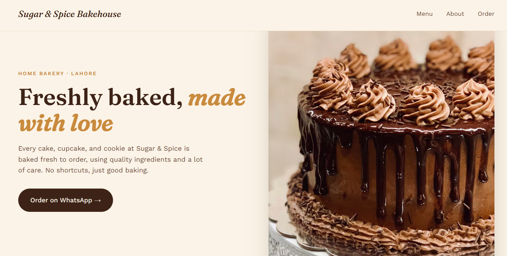

# 🍰 Sugar & Spice Bakehouse

A modern, responsive website for **Sugar & Spice Bakehouse**, a home bakery concept based in Lahore. The website presents freshly baked desserts in a warm, elegant layout and makes it easy for visitors to explore the menu and find ordering options.

## 🖥️ Website Preview

**[View the Project Repository](https://sugarspicebakehouse.netlify.app/)**

## ✨ Features

- Elegant bakery-inspired design
- Responsive layout for mobile and desktop screens
- Hero section with bakery introduction
- Bakery story section
- Dessert menu with product images and prices
- Custom dessert information
- Order and contact call-to-action
- WhatsApp and Instagram contact links

## 🍰 Menu Highlights

- Chocolate Fudge Cake
- Red Velvet Cupcakes
- Vanilla Birthday Cake
- Assorted Cookies Box

## 🛠️ Technologies Used

- **HTML5** — Website structure
- **CSS3** — Styling, layout, and responsive design
- **Google Fonts** — Fraunces and Work Sans typography

## 🚀 Run Locally

1. Clone or download this repository.
2. Open the project folder.
3. Open `index.html` in your web browser.

This project is a standalone HTML page and does not require a package installation.

## 🎯 Project Goal

The goal of this project is to create an inviting online presence for a bakery, display dessert options clearly, and provide visitors with convenient ways to enquire about orders.

## 👩‍💻 Author

**Fiza Batool**

- GitHub: [Fiza-batool](https://github.com/Fiza-batool)

---

*Sugar & Spice Bakehouse — Freshly baked, made with love.*
